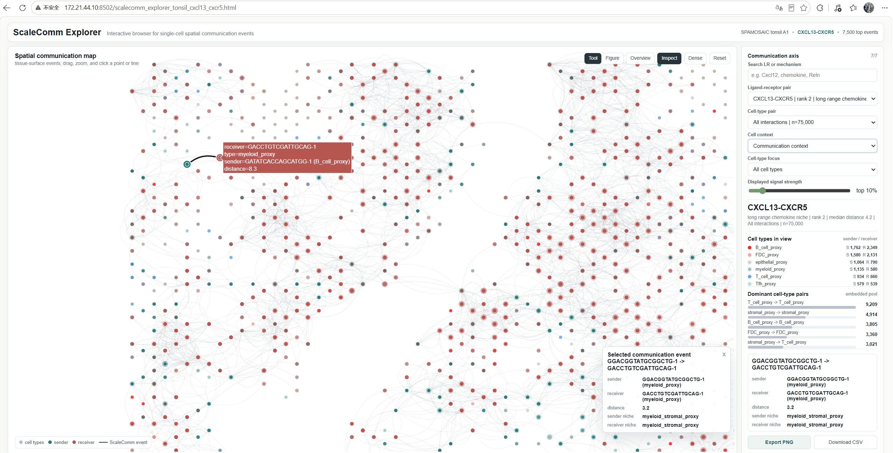
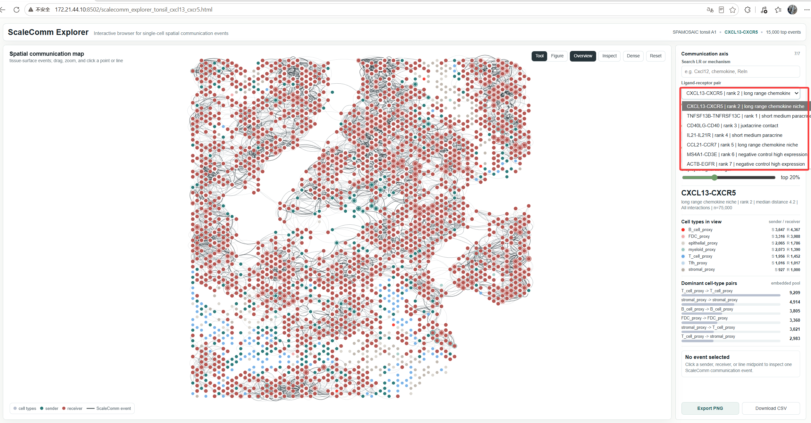
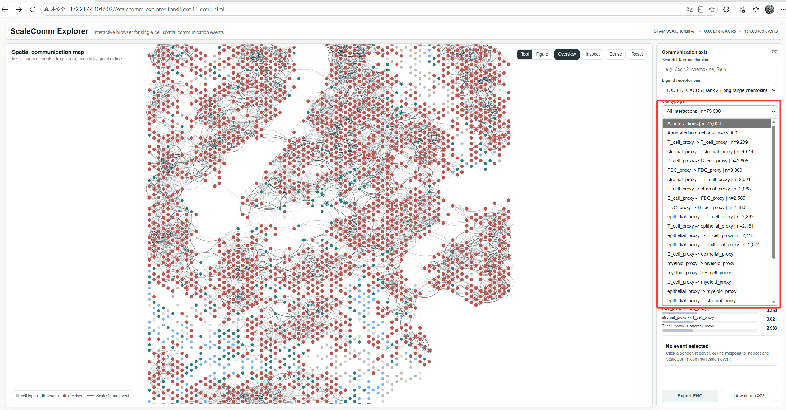
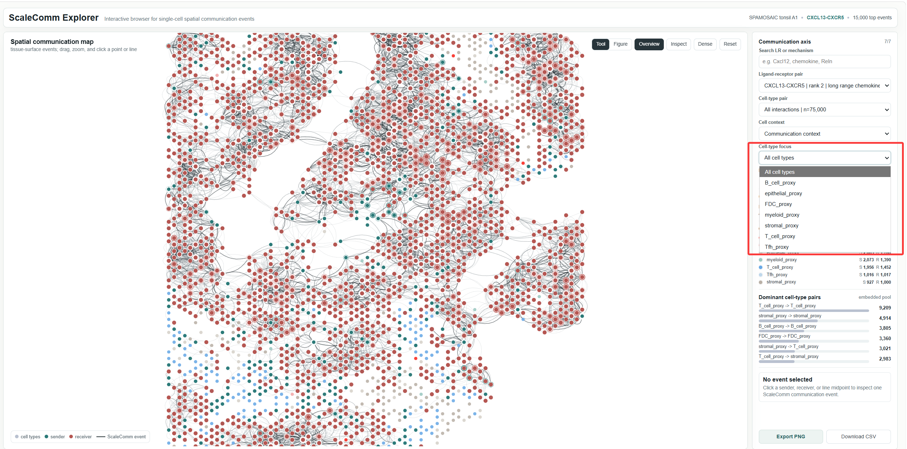

# ScaleComm Explorer: SpaMosaic Tonsil A1

This standalone browser is the interactive companion to the SpaMosaic tonsil A1 `CXCL13-CXCR5` case study in revised manuscript Figure 6. It contains an embedded, read-only ScaleComm result payload, so it can be opened without Python, a database, or model retraining.

## Launch

Serve this directory from the repository root:

```bash
python3 -m http.server 8502 --bind 0.0.0.0 --directory apps/scalecomm_explorer
```

Open:

```text
http://localhost:8502/scalecomm_explorer_tonsil_cxcl13_cxcr5.html
```

For a remote workstation, replace `localhost` with the workstation address. The page can also be opened as a local HTML file in modern browsers, but serving it over HTTP is recommended for consistent browser behaviour.

## Provenance

The browser payload is a released, embedded A1 result export for the current
ScaleComm analysis. Its internal file identifier contains
`spatialself_wavelet_scale`; this is a legacy API identifier, whereas the
manuscript describes the representation as multi-scale graph diffusion. The
accompanying JSON manifest records the dataset, default LR axis, browser asset
and documentation paths. The browser is a visualization layer over exported
result tables; it neither retrains the model nor changes any scores.

## Browser functions

| Function | Use |
|---|---|
| LR search and selection | Searches the seven exported tonsil LR axes and switches the displayed spatial event set. |
| Cell-type-pair filter | Restricts the displayed events to a sender-receiver annotation pair. |
| Cell-type focus | Highlights events involving a chosen cell type. |
| Signal-strength slider | Adjusts the displayed top fraction of the selected event set. |
| Map modes | Provides overview, inspect, and dense display modes, with pan and zoom. |
| Event inspection | Clicking an edge, sender, or receiver exposes the corresponding event metadata. |
| Export | Downloads the current spatial view as PNG or the displayed event table as CSV. |

The default view is the manuscript `CXCL13-CXCR5` case in SpaMosaic tonsil A1. The default scale and score display should be interpreted as dataset-specific ScaleComm outputs for prioritization and visualization, not as calibrated probabilities, molecular diffusion distances, or direct proof of active communication.

## Screenshots



The default `CXCL13-CXCR5` view shows the spatial event map, hover metadata, selected-event inspector, and PNG/CSV export controls.



The LR selector exposes all seven exported tonsil axes, including the default `CXCL13-CXCR5` case.



The cell-type-pair selector restricts the visualized candidate event set without modifying the underlying scores.



The cell-type focus control supports inspection of events involving a selected annotated cell type.

## Reproducibility boundary

This browser package is intended for interactive inspection of the published result tables. The full model-training, benchmark, and figure-generation workflows are available elsewhere in the repository and its associated reproducibility materials. Biological interpretation of high-ranking events should consider spatial context, receiver evidence, and independent validation.
